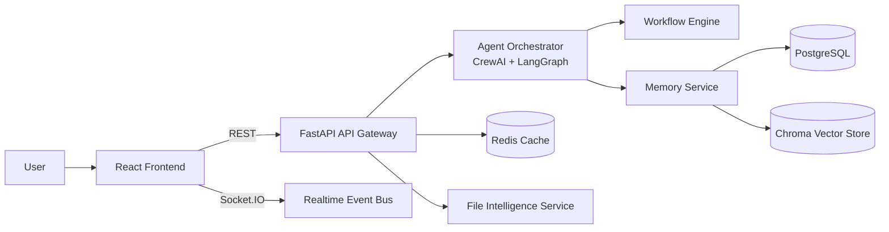

# System Architecture

## Service Boundaries
- `frontend`: UX shell and AI interfaces.
- `backend`: API gateway, auth, websocket, business orchestration.
- `agents`: Multi-agent strategy and collaboration protocols.
- `memory`: Long-term memory policy and storage lifecycle.
- `workflows`: Autonomous plan-execute-review task chains.

## Scale Path
- Split backend services by domain (`chat`, `memory`, `workflow`, `files`) into separate deployments.
- Promote Redis to queue backend for async worker fleet.
- Add model router for hybrid cloud/local inference.
